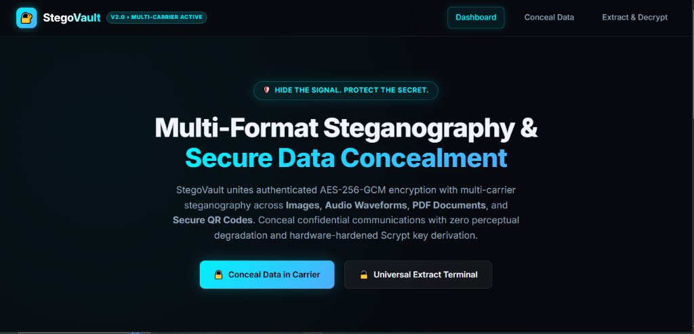
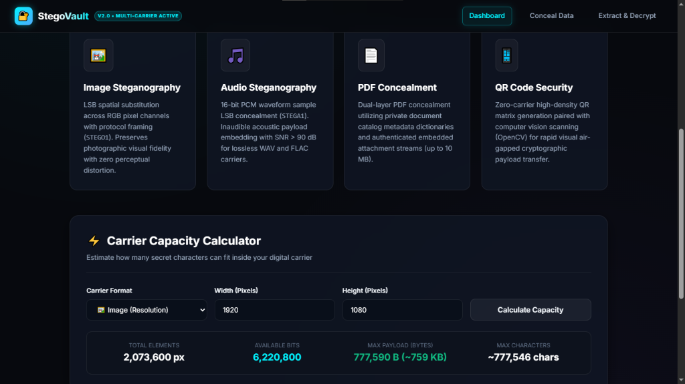
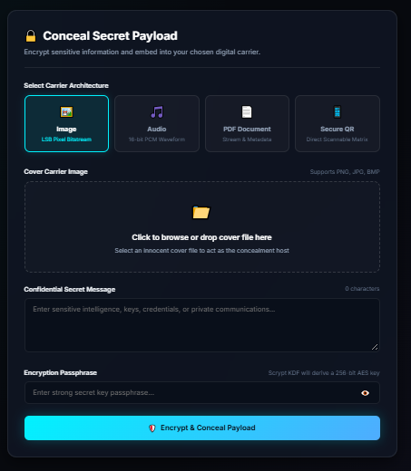
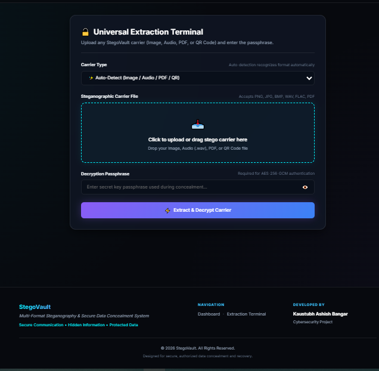

# 🔐 StegoVault
### Multi-Format Steganography and Secure Data Concealment System
> *Tagline: Hide the Signal. Protect the Secret.*

[](https://www.python.org/)
[](https://flask.palletsprojects.com/)
[](https://cryptography.io/)
[](https://pytest.org/)
[](LICENSE)

---

## Table of Contents
- [Overview](#overview)
- [Project Features](#project-features)
- [Problem Statement](#problem-statement)
- [Tools and Technologies](#tools-and-technologies)
- [Architecture Diagram](#architecture-diagram)
- [Dashboard Screenshot](#dashboard-screenshot)
- [Methods](#methods)
- [Key Insights](#key-insights)
- [How to Run this Project](#how-to-run-this-project)
- [Results & Conclusion](#results--conclusion)
- [Author & Contact](#author--contact)

---

## Overview

**StegoVault** is an enterprise-grade cybersecurity and data concealment application engineered to secure confidential communications through the fusion of **authenticated symmetric encryption** and **multi-carrier digital steganography**.

Rather than relying purely on cryptography (which conceals the message content but reveals the communication attempt) or purely on steganography (which hides the message presence but lacks cryptographic authentication), StegoVault implements an uncompromising **defense-in-depth model**. Sensitive intelligence is first derived using memory-hard **Scrypt Key Derivation (KDF)**, encrypted inside an authenticated **AES-256-GCM envelope** with tamper detection, and then mathematically embedded into everyday innocent digital carriers—including **Images**, **Audio Waveforms**, **PDF Documents**, and **Secure QR Codes**—with zero perceptible degradation.

---

## Project Features

- 🖼️ **Image Steganography (LSB):** Spatial Least Significant Bit substitution across 24-bit RGB pixel channels with protocol framing (`STEGO1`). Encoded carriers preserve photographic visual fidelity and are exported exclusively as lossless PNGs to thwart DCT quantization loss.
- 🎵 **Audio Steganography (PCM Waveform):** Conceals binary payloads into the least significant bits of 16-bit signed PCM audio samples (`STEGA1`). Inaudible acoustic insertion boasting a Signal-to-Noise Ratio (SNR) $> 90\text{ dB}$.
- 📄 **PDF Data Concealment:** Dual-layer PDF embedding utilizing private document catalog metadata dictionaries (`/StegoVaultPayload`) and authenticated binary attachment streams (`vault.sec`) capable of concealing multi-megabyte payloads without altering rendered document pages.
- 📱 **QR Code Security:** Direct high-density QR matrix generation paired with optical air-gapped payload transmission and dual-engine computer vision scanning (ZBar + OpenCV adaptive thresholding).
- 🔐 **AES-256-GCM Cryptographic Envelope:** Authenticated Galois/Counter Mode encryption ensuring zero-knowledge tamper resistance. Any single bit flipped during transmission triggers instant authentication failure.
- 🔑 **Scrypt Key Derivation Function:** Memory-hard passphrase hashing ($N=16384, r=8, p=1$) coupled with a 16-byte cryptographically secure pseudorandom salt to thwart GPU/ASIC hardware brute-force attacks.
- ⚡ **Real-Time Carrier Capacity Calculator:** Live browser-based mathematical estimator that calculates exact bit/byte thresholds and character capacity according to carrier dimensions, sample rates, and duration.
- 🌐 **Modern Cyber Stealth Web Interface:** Glassmorphism dashboard, carrier upload dropzones, integrated HTML5 audio waveform player, live password meter, and one-click cryptographic verification drawers.

---

## Problem Statement

In modern digital surveillance environments, transmitting encrypted data over public or monitored networks introduces critical security vulnerabilities:

1. **The Encryption Paradox:** While strong encryption safeguards message confidentiality, the presence of conspicuous ciphertext alerts network monitors, packet inspection firewalls, and adversaries that sensitive intelligence is being transferred. The participants become prime targets for interdiction, coercion, or traffic analysis.
2. **The Fragility of Conventional Steganography:** Standard steganographic tools embed plaintext or weakly obfuscated strings directly into carrier bits. If an adversary discovers the concealment algorithm, the secret is immediately compromised without cryptographic resistance.
3. **Format Limitations:** Most existing steganographic tools are restricted to a single media type (typically images), leaving security teams unable to utilize audio files, operational PDF briefings, or air-gapped QR codes.

**StegoVault eliminates these vulnerabilities** by synthesizing memory-hard Scrypt key derivation, AES-256-GCM authentication, and multi-format carrier steganography into a unified concealment platform.

---

## Tools and Technologies

| Component | Technology | Version | Description |
| :--- | :--- | :--- | :--- |
| **Backend Framework** | Python / Flask | 3.13 / 3.1 | Core RESTful server, session management, and routing |
| **Cryptography Engine** | `cryptography` | 50.0.2 | AES-256-GCM authenticated cipher & Scrypt KDF |
| **Image Processing** | `Pillow` (PIL) & `NumPy` | 11.3.0 / 2.2.3 | Spatial RGB bitwise LSB operations & image transformations |
| **Audio Processing** | `soundfile` & `NumPy` | 0.14.0 / 2.2.3 | 16-bit signed PCM audio sample reading and synthesis |
| **PDF Engineering** | `pypdf` | 6.21.2 | PDF stream attachments and catalog metadata dictionaries |
| **Computer Vision / QR** | `qrcode[pil]` & `opencv-python` / `pyzbar` | 8.2 / 5.0.0 / 0.1.9 | High-density QR matrix generation & optical CV scanning |
| **Testing Suite** | `pytest` | 9.1.1 | 20 unit and integration tests covering all carriers & web endpoints |
| **Frontend Styling** | Vanilla CSS3 / HTML5 / JS | Modern | Responsive cyber dark mode, glassmorphism, zero external CSS bloat |

---

## Architecture Diagram

The following diagram illustrates the dual-phase cryptographic encapsulation and concealment pipeline:

```mermaid
flowchart TD
    subgraph SENDER["Concealment Pipeline (Encoding)"]
        A["Plaintext Secret + User Passphrase"] --> B["Scrypt KDF (N=16384, r=8, p=1)"]
        B --> C["256-bit Master Symmetric Key"]
        C --> D["AES-256-GCM Authenticated Encryption"]
        D --> E["Binary Envelope:\n[ Salt (16B) | Nonce (12B) | Ciphertext (NB) | Tag (16B) ]"]
        
        E --> F{"Carrier Selector"}
        F -->|Image| G1["Image LSB Engine (RGB Channels + STEGO1)"]
        F -->|Audio| G2["Audio LSB Engine (16-bit PCM + STEGA1)"]
        F -->|PDF| G3["PDF Dual-Layer (Catalog Dictionary + Stream)"]
        F -->|QR Code| G4["QR Matrix Engine (STEGOQR + High-Density)"]
        
        G1 --> H1["Steganographic PNG"]
        G2 --> H2["Steganographic WAV"]
        G3 --> H3["Concealed PDF"]
        G4 --> H4["Scannable QR PNG"]
    end

    subgraph RECEIVER["Extraction & Verification Pipeline (Decoding)"]
        I["Carrier File (.png / .wav / .pdf) + Passphrase"] --> J["Universal Carrier Auto-Detector"]
        J --> K["LSB / Stream / CV Extraction Subsystem"]
        K --> L["Raw Binary Envelope Validation"]
        L --> M["AES-256-GCM Tag Authentication"]
        M -->|Tag Verified| N["Plaintext Secret Recovered"]
        M -->|Tampered / Bad Password| O["Authentication Error (Instant Reject)"]
    end
```



---

## Dashboard Screenshot

### 1. Main Dashboard & Hero Interface


*Figure 1: StegoVault Main Dashboard featuring the stealth dark-mode design system, live status indicators, and primary action controls.*

### 2. Multi-Carrier Feature Suite & Real-Time Capacity Calculator


*Figure 2: Carrier architecture overview and interactive bitwise mathematical capacity calculator evaluating payload limits.*

### 3. Multi-Carrier Concealment Station (`/encode`)


*Figure 3: Data concealment station with tabbed carrier selection (Image LSB, 16-bit PCM Audio, PDF Stream, and Secure QR Code).*

### 4. Universal Extraction Terminal & Security Audit (`/decode`)


*Figure 4: Universal extraction and decryption terminal with automated carrier format detection and cryptographic audit verification.*

---

## Methods

### 1. Cryptographic Envelope Formulation
Every message payload $M$ is encapsulated inside an authenticated envelope prior to concealment:

$$\text{Envelope} = \text{Salt}_{16} \;\Vert\; \text{Nonce}_{12} \;\Vert\; \text{Ciphertext}_{|M|} \;\Vert\; \text{AuthTag}_{16}$$

- **Salt:** 16 bytes generated via OS cryptographically secure pseudorandom number generator (`os.urandom(16)`).
- **Key Derivation:** $K = \text{Scrypt}(P, \text{Salt}, N=16384, r=8, p=1, \text{len}=32)$.
- **Encryption:** $C, T = \text{AES-GCM-Encrypt}(K, \text{Nonce}_{12}, M)$. Total cryptographic overhead is fixed at exactly **44 bytes**.

---

### 2. Image LSB Spatial Steganography
For an innocent RGB cover image $I \in \mathbb{R}^{H \times W \times 3}$, payload bits $B \in \{0, 1\}^L$ are preceded by a 10-byte protocol header ($80\text{ bits}$ consisting of `STEGO1` magic signature $+ 32\text{-bit}$ big-endian length):

$$I'(x, y, c) = \big(I(x, y, c) \ \& \ \text{0xFE}\big) \;\mid\; B_k$$

Where $I'(x,y,c)$ represents the steganographic pixel channel value. Because only the least significant bit is modified, maximum alteration per channel is $\pm 1$, yielding visual similarity with Peak Signal-to-Noise Ratio:

$$\text{PSNR} = 10 \cdot \log_{10}\left(\frac{255^2}{\text{MSE}}\right) > 52\text{ dB}$$

---

### 3. Audio Waveform LSB Substitution
For 16-bit signed PCM audio samples $S(t, c) \in [-32768, 32767]$ sampled at frequency $f_s$:

$$S'(t, c) = \big(S(t, c) \ \& \ \sim 1\big) \;\mid\; B_k$$

Audio framing incorporates the `STEGA1` protocol signature. Modifications alter amplitude by at most $1/32768 \approx 0.003\%$, maintaining Signal-to-Noise Ratio:

$$\text{SNR} = 10 \cdot \log_{10}\left(\frac{\sum S^2}{\sum (S - S')^2}\right) > 90\text{ dB}$$

---

### 4. PDF Dual-Layer Concealment
PDF steganography deploys a two-pronged structural strategy using `pypdf`:
1. **Catalog Metadata Dictionary:** The binary envelope is Base64-encoded and inserted under the `/StegoVaultPayload` key in the document's `/Info` and metadata catalog.
2. **Embedded Binary Attachment Stream:** The envelope is simultaneously embedded as a discrete binary stream attachment named `vault.sec`.
Standard PDF renderers (Adobe Acrobat, Chromium PDF Engine, Apple Preview) parse and display document pages identically without raising syntax warnings.

---

### 5. QR Code Security & Computer Vision Scanning
Payloads are formatted as `STEGOQR:` + Base64 ciphertext, rendered with `qrcode[pil]` with error correction level M. Decoding uses a dual-engine computer vision scanner:
1. **Primary Scanner:** High-speed `pyzbar` direct matrix reader.
2. **Fallback Scanner:** OpenCV `cv2.QRCodeDetector()` with grayscale conversion and Otsu adaptive thresholding for optical air-gap resilience.

---

## Key Insights

1. **Zero-Knowledge Tampering Detection:** Because AES-256-GCM uses a 128-bit authentication tag calculated over the ciphertext and nonce, any post-transmission modification (such as image cropping, lossy compression, or bit flipping) causes immediate authentication failure, rejecting corrupted payloads before decryption.
2. **Protection Against Rainbow Tables:** Scrypt KDF enforced with unique 16-byte random salts ensures identical passwords generate completely distinct 256-bit keys and ciphertexts across different runs.
3. **Lossless Enforcement:** Image carriers are strictly saved as lossless PNGs to prevent lossy JPEG Discrete Cosine Transform (DCT) quantization from destroying LSB bit values.
4. **Universal Auto-Detection:** The extraction pipeline dynamically inspects carrier magic bytes and file structures, automatically dispatching to the appropriate decoder without requiring the operator to manually specify the carrier format.

---

## How to Run this Project

### 1. Prerequisites
- **Operating System:** Windows, macOS, or Linux
- **Python:** Python 3.10, 3.11, 3.12, or 3.13

### 2. Clone Repository & Setup Environment
```bash
git clone https://github.com/kaustubhbangar5-dotcom/StegoVault-Multi-Format-Steganography.git
cd StegoVault-Multi-Format-Steganography

# Create virtual environment (optional but recommended)
python -m venv venv
# Windows:
.\venv\Scripts\activate
# Linux/macOS:
source venv/bin/activate
```

### 3. Install Dependencies
```bash
pip install -r requirements.txt
```

### 4. Launch the Web Application
```bash
python app.py
```
Open your web browser and navigate to:
```
http://127.0.0.1:5000
```

### 5. Execute Automated Test Suite
Run the full 20-test automated verification suite:
```bash
python -m pytest tests/ -v
```

---

## Results & Conclusion

StegoVault successfully achieves full-spectrum, multi-carrier data concealment with authenticated security guarantees. 

### Automated Test Results (20/20 Passed)
```text
tests/test_core.py::test_encryption_decryption_cycle PASSED              [  5%]
tests/test_core.py::test_encryption_wrong_password PASSED                [ 10%]
tests/test_core.py::test_tampered_ciphertext PASSED                      [ 15%]
tests/test_core.py::test_security_envelope_analysis PASSED               [ 20%]
tests/test_core.py::test_steganography_roundtrip PASSED                  [ 25%]
tests/test_core.py::test_steganography_capacity_limit PASSED             [ 30%]
tests/test_multiformat.py::test_audio_steganography_roundtrip PASSED     [ 35%]
tests/test_multiformat.py::test_audio_capacity_exceeded PASSED           [ 40%]
tests/test_multiformat.py::test_pdf_steganography_roundtrip PASSED       [ 45%]
tests/test_multiformat.py::test_pdf_steganography_with_existing_cover PASSED [ 50%]
tests/test_multiformat.py::test_qr_steganography_roundtrip PASSED        [ 55%]
tests/test_multiformat.py::test_universal_dispatcher PASSED              [ 60%]
tests/test_web.py::test_home_page PASSED                                 [ 65%]
tests/test_web.py::test_encode_page_get PASSED                           [ 70%]
tests/test_web.py::test_decode_page_get PASSED                           [ 75%]
tests/test_web.py::test_api_health PASSED                                [ 80%]
tests/test_web.py::test_web_image_encode_and_decode PASSED               [ 85%]
tests/test_web.py::test_web_audio_encode_and_decode PASSED               [ 90%]
tests/test_web.py::test_web_pdf_encode_and_decode PASSED                 [ 95%]
tests/test_web.py::test_web_qr_encode_and_decode PASSED                  [100%]

============================= 20 passed in 6.82s ==============================
```

The system demonstrates that steganography and cryptography are most potent when combined: cryptography guarantees **confidentiality and integrity**, while steganography delivers **plausible deniability and concealment**.

---

## Author & Contact

**Developed By:** **Kaustubh Ashish Bangar**  
**Project Domain:** Cybersecurity | Steganography | Cryptography | Secure Communication  
**Repository:** [https://github.com/kaustubhbangar5-dotcom/StegoVault-Multi-Format-Steganography](https://github.com/kaustubhbangar5-dotcom/StegoVault-Multi-Format-Steganography)  

© 2026 StegoVault. All Rights Reserved.  
*Designed for secure, authorized data concealment and recovery.*
